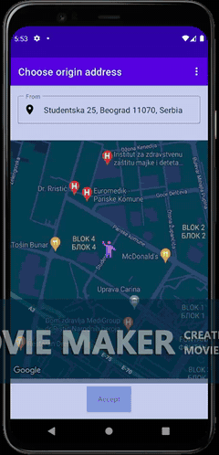
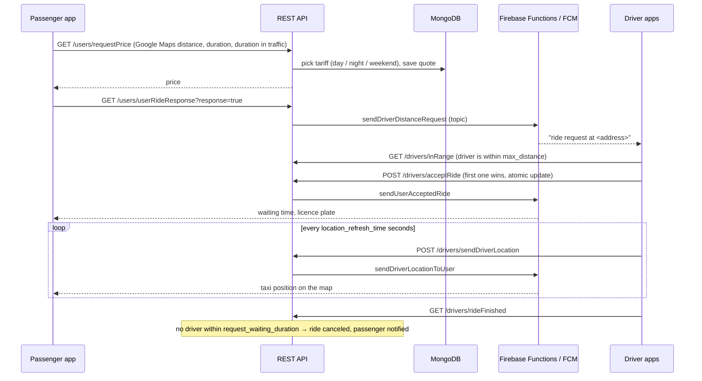

# TaxiApp: ride-hailing backend

[](https://github.com/FansteLK/Mobile-app-for-taxi-services/actions/workflows/ci.yml)

Backend for an Android taxi app with two roles, **passenger** and **driver**. Before booking, a passenger sees a price estimate that accounts for live traffic congestion. Nearby drivers get the request as a push notification, the first to accept gets the ride, and the passenger can follow the taxi on a map. Drivers see daily, weekly and yearly earnings statistics.

This repository contains the **REST API** (Node.js, Express, TypeScript, MongoDB) and the **Firebase Cloud Functions** that deliver push notifications (FCM). The Android client is not included.

| Passenger | Driver |
| --- | --- |
|  |  |

*Recordings of the Android app, at 2× speed.*

## How a ride works



### Pricing

```
price = starting price + price per km × (distance − 1 km) × traffic coefficient
traffic coefficient = 1 + ½ × (duration in traffic / normal duration − 1)
```

The tariff (starting price and per-km rate) depends on whether it is night (22:00–07:00) or the weekend. A trip that takes twice as long because of traffic costs 1.5× per kilometre. See [`src/pricing.ts`](backend/src/pricing.ts) and its tests.

## Running it

```bash
docker compose up --build          # MongoDB + seed data + API on http://localhost:4000
```

The seed creates `passenger@example.com` and `driver@example.com`, both with the password `Demo1234`.

```bash
curl -s localhost:4000/users/login -H 'Content-Type: application/json' \
  -d '{"email":"passenger@example.com","password":"Demo1234"}'
curl -s 'localhost:4000/users/requestPrice?user_email=passenger@example.com&origin=Slavija&destination=Zemun&distance=8400&duration=900&traffic_duration=1500'
# {"price":"1009.33"}   (weekday daytime tariff: 220 + 80 × 7.4 km × 1.33 traffic)
```

Push notifications go through the functions in [`backend/functions`](backend/functions). Set `FUNCTIONS_BASE_URL` to your deployed functions to enable them; without it, the API only logs them.

### Development

```bash
cd backend
npm install
npm test          # unit tests + API tests against an in-memory MongoDB
npm run dev       # needs MongoDB on localhost:27017 (or set MONGODB_URI)
npm run seed
```

## API

| Passenger | | Driver | |
| --- | --- | --- | --- |
| `POST /users/register` | create an account | `POST /drivers/changeActivity` | available / unavailable |
| `POST /users/login` | | `GET /drivers/inRange` | show a nearby request |
| `GET /users/requestPrice` | quote a ride | `POST /drivers/acceptRide` | |
| `GET /users/userRideResponse` | accept / decline quote | `POST /drivers/sendDriverLocation` | live location |
| `GET /users/getActiveRide` | ride status, taxi details | `GET /drivers/getActiveRide` | |
| `GET /users/getRides` | ride history | `GET /drivers/rideFinished` | |
| | | `POST /drivers/setUserIrregular` | report a no-show |
| | | `GET /drivers/getTodayStatistic`, `getStatistic`, `getMonthStatistic` | earnings |
| | | `GET /drivers/getRideWaitingDuration`, `getMaxDistance`, `getLocationRefreshTime` | runtime settings |

## Changes since the original version

The API was rewritten with async/await on Mongoose 8, with tests and Docker. Routes and response formats are unchanged so the existing app keeps working.

- **Fixed:**
  - Confirming a ride never worked, because the lookup used a misspelled field (`user-email`). The no-driver timeout also never fired.
  - Several endpoints never sent a response on some code paths, so requests hung.
  - Login returned the password hash.
  - Monthly statistics counted the last day of each month twice.
  - Trips under 1 km were priced below the starting fare.
  - Query parameters could carry MongoDB operators (`?email[$ne]=`).
- **Removed:**
  - The committed build output.
  - A Firebase service-account file. The functions now use default credentials.
  - Unused imports of server-side Firebase modules in the API.
  - The 35 MB of videos, replaced by the GIFs above.
- **Configuration:** `MONGODB_URI`, `PORT` and `FUNCTIONS_BASE_URL` come from the environment.
